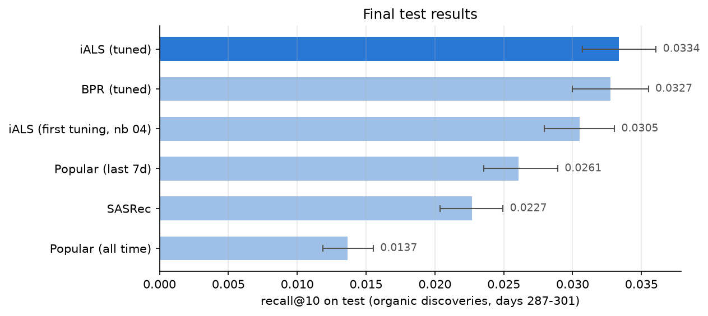

# Music discovery recommender

Recommending tracks a listener has never played, on 46M listening events from Yandex Music.
Models are trained on the past and judged on what users discover over the next two weeks.



## The task

71% of listens are replays. A model that recommends a user's favourites scores well offline and is useless,
so the task here is discovery:

> For each user, rank tracks they have **never played**. A hit is a track they then find **on their own**
> and play at least halfway, within the next 14 days.

"On their own" matters: 65% of first-time listens come from the platform's recommendations. Counting those
would partly measure how well a model imitates Yandex's recommender.

## Data

[Yambda-50M](https://huggingface.co/datasets/yandex/yambda) (Yandex, 2025, Apache 2.0): 46.5M listens,
9,238 users, 877K tracks, about 301 days. Each listen has an organic/recommended flag and the share of the
track played. Not included in this repo.

## Evaluation

- Global time split. Validation: train before day 273, evaluate days 273–287. Test: train before day 287, evaluate days 287–301.
- Every decision (filters, hyperparameters, epochs) was made on validation. The test split was used once, at the end.
- A track needs at least 5 listeners in training to be recommendable, a user at least 10 tracks. As a result, 24% of test discoveries are out of reach for any model here (brand-new tracks or new users).
- Metrics: recall@10 (hits / min(10, number of discoveries)), NDCG@10, hit rate@10 (share of users with at least one hit), catalogue coverage. Gaps between models are tested with a paired bootstrap over users.

## Results

Test split, 6,306 users with at least one discovery.

| Model | recall@10 | hit rate@10 | coverage@10 | recall@10 (validation) |
|---|---|---|---|---|
| iALS, tuned | **0.0334** | **15.1%** | 5.6% | 0.0346 |
| BPR matrix factorization (PyTorch) | 0.0327 | 14.8% | 3.4% | 0.0334 |
| iALS, first pass | 0.0305 | 14.2% | 3.9% | 0.0294 |
| Most popular, last 7 days | 0.0261 | 11.0% | 0.06% | 0.0235 |
| SASRec (PyTorch Transformer) | 0.0227 | 10.8% | 9.0% | 0.0268 |
| Most popular, all time | 0.0137 | 6.1% | 0.09% | 0.0121 |

- iALS vs. last-7-day popularity: +28% (95% CI +15% to +40%).
- iALS vs. BPR: +2%, not significant.
- The ranking of models is the same on validation and test.
- ItemKNN matched popularity on validation and took 17x longer to train than iALS, so it was dropped.

## Findings

**1. Recency is the strongest signal.** Popularity over the last 7 days is twice as good as all-time popularity.
Weighting each listen by its age (7-day half-life) raised iALS validation recall from 0.018 to 0.028, and a
3-day half-life doubled BPR. The tracks people seek out are mostly the ones heating up right now.

**2. The target definition changes the conclusion.** If discoveries made through the platform's
recommendations also count, iALS beats popularity by 2.2x instead of 1.3x. Collaborative filtering is very
good at predicting what the platform itself will push.

**3. A well-tuned iALS is hard to beat.** Tuning half-life, regularization and size added 9% (significant).
BPR ties it. SASRec trails by 32%; three targeted fixes (loss only on first listens, recent training
windows, more negatives) did not close the gap.

**4. Same score, different behaviour.** iALS gives 57% of its top 10 to artists the user already knows and
is best on those tracks (recall 0.038 vs. 0.028 for BPR). BPR gives 39% and is better at new artists
(0.023 vs. 0.017). The overall metric hides this, and which model is better depends on whether the product
wants depth or exploration.

**5. iALS and SASRec find different things.** 15.1% of users get a hit from iALS, 10.8% from SASRec and
20.7% from either. Per-user recall correlates at only 0.37. That is the case for a two-stage system with a
learned ranker on top of both.

## Repo

```
src/musicrec/
  yambda.py          load Yambda, build the event table
  preprocess.py      time split, filters, target definition
  evaluation.py      metrics, paired bootstrap, artist segments
  models/            popularity, ItemKNN, iALS, BPR, SASRec
notebooks/yambda/    01-11 in order (08-10 run on a Colab GPU)
notebooks/lastfm/    first version of the project on Last.fm-1K
reports/             result tables and figures
```

## Running it

```bash
uv sync
# put Yambda flat/50m/*.parquet and artist_item_mapping.parquet in data/raw/yambda/
# then run notebooks/yambda/01-11 in order
```

## Limitations

- One platform, 10 months, anonymized IDs (no track names, no calendar dates).
- Offline evaluation only. An A/B test would measure discovery rate and skips, with total listening time as a guardrail.
- Cold start: 24% of discoveries cannot be reached by collaborative filtering. Yambda's audio embeddings are the natural fix.

## Next

- Two-stage ranking: candidates from iALS, SASRec and popularity, re-ranked by LightGBM on model scores, recency and artist-familiarity features.
- Audio embeddings for cold-start tracks.
