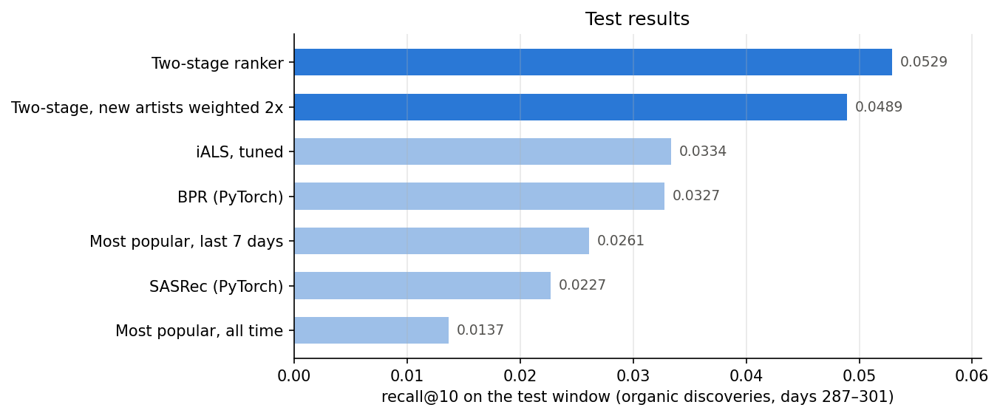
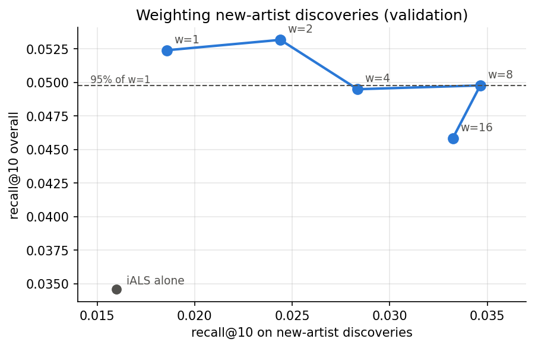

# Music discovery recommender

Recommending tracks a listener has never played, on 46M listening events from Yandex Music.
Models are trained on the past and judged on what users discover over the next two weeks.

The final system pulls candidates from iALS, SASRec, BPR and recent popularity and re-ranks them with
LightGBM: **recall@10 0.053 on the test window, +59% over a tuned iALS and twice popularity.** Weighting
new-artist discoveries 2x trades 8% of that for 19% more hits on artists the user has never played.



## The task

71% of listens are replays. A model that recommends a user's favourites scores well offline and is useless,
so the task here is discovery:

> For each user, rank tracks they have **never played**. A hit is a track they then find **on their own**
> and play at least halfway, within the next 14 days.

"On their own" matters: 65% of first-time listens come from the platform's recommendations. Counting those
would partly measure how well a model imitates Yandex's recommender.

## Data

[Yambda-50M](https://huggingface.co/datasets/yandex/yambda) (Yandex, 2025, Apache 2.0): 46.5M listens,
9,238 users, 877K tracks, about 301 days. Each listen has an organic/recommended flag and the share of the
track played. Not included in this repo.

## Evaluation

- Global time split. Validation: train before day 273, evaluate days 273–287. Test: train before day 287, evaluate days 287–301.
- Every decision (filters, hyperparameters, epochs, ranker features) was made on validation. Each model was run on test once.
- A track needs at least 5 listeners in training to be recommendable, a user at least 10 tracks. 24% of test discoveries are therefore out of reach for any model here (brand-new tracks or new users).
- Metrics: recall@10 (hits / min(10, number of discoveries)), NDCG@10, hit rate@10 (share of users with at least one hit), catalogue coverage. Gaps between models are tested with a paired bootstrap over users.

## Results

Test window, 6,306 users with at least one discovery.

| Model | recall@10 | new-artist recall@10 | hit rate@10 | coverage@10 | recall@10 (validation) |
|---|---|---|---|---|---|
| Two-stage ranker | **0.0529** | 0.0185 | **22.2%** | 6.1% | 0.0524 |
| Two-stage ranker, new artists weighted 2x | 0.0489 | 0.0220 | 21.1% | 6.2% | 0.0532 |
| Two-stage ranker, first version | 0.0490 | 0.0157 | 20.9% | 7.0% | 0.0455 |
| Rank fusion, no training (RRF) | 0.0349 | – | 16.5% | 5.9% | 0.0387 |
| iALS, tuned | 0.0334 | 0.0169 | 15.1% | 5.6% | 0.0346 |
| BPR matrix factorization (PyTorch) | 0.0327 | 0.0225 | 14.8% | 3.4% | 0.0334 |
| iALS, first pass | 0.0305 | 0.0174 | 14.2% | 3.9% | 0.0294 |
| Most popular, last 7 days | 0.0261 | 0.0244 | 11.0% | 0.06% | 0.0235 |
| SASRec (PyTorch Transformer) | 0.0227 | 0.0124 | 10.8% | 9.0% | 0.0268 |
| Most popular, all time | 0.0137 | 0.0134 | 6.1% | 0.09% | 0.0121 |

- Two-stage ranker: iALS, SASRec, BPR and popularity candidates; LightGBM LambdaRank on their scores, track recency and popularity, organic-listening signals and artist familiarity. The first version had three sources and no organic features.
- Two-stage vs. first version: +8% (95% CI +3% to +13%). First version vs. iALS: +47% (CI +38% to +56%). iALS vs. last-7-day popularity: +28% (CI +15% to +40%).
- iALS vs. BPR: +2%, not significant. RRF vs. iALS on test: +5%, not significant.
- ItemKNN matched popularity on validation and took 17x longer to train than iALS, so it was dropped.

## Findings

**1. Recency is the strongest signal.** Popularity over the last 7 days is twice as good as all-time popularity.
Weighting each listen by its age (7-day half-life) raised iALS validation recall from 0.018 to 0.028, and a
3-day half-life doubled BPR. The tracks people seek out are mostly the ones heating up right now.

**2. The target definition changes the conclusion.** If discoveries made through the platform's
recommendations also count, iALS beats popularity by 2.2x instead of 1.3x. Collaborative filtering is very
good at predicting what the platform itself will push.

**3. A well-tuned iALS is hard to beat with a single model.** Tuning half-life, regularization and size added
9% (significant). BPR ties it. SASRec trails by 32%; three targeted fixes (loss only on first listens, recent
training windows, more negatives) did not close the gap.

**4. Same score, different behaviour.** iALS gives 57% of its top 10 to artists the user already knows and
is best on those tracks (recall 0.038 vs. 0.028 for BPR). BPR gives 39% and is better at new artists
(0.023 vs. 0.017). Which model is better depends on whether the product wants depth or exploration.

**5. Combining models works because they find different things.** 15.1% of users get a hit from iALS, 10.8%
from SASRec and 20.7% from either; per-user recall correlates at only 0.37. A LightGBM ranker over the
union of candidates turns this into +59%. Its most useful features are track age, how often the user has
played the track's artist, iALS rank, and the share of the track's listens that were organic. Adding the
organic-listening features alone was worth +12% on validation.

**6. The first ranker result was leaked.** Cross-validating the ranker by user within the validation window
showed +54%. But users in the same two weeks discover the same tracks (65% overlap between folds), so the
ranker was memorising which tracks blew up in that window. Training it on an earlier window (labels from
days 259–273) and evaluating on the next one gave an honest +31% on validation.

**7. New-artist discovery is a dial, not a free win.** Without help, the ranker's gains are almost all on
artists the user already knows. Counting a new-artist discovery `w` times in the ranking loss moves along a
curve: on validation, w = 8 nearly doubled new-artist recall for a 5% drop overall. w = 2 looked free on
validation; on test it cost 8% overall for 19% more new-artist hits.



## Repo

```
src/musicrec/
  yambda.py          load Yambda, build the event table
  preprocess.py      time split, filters, target definition
  evaluation.py      metrics, paired bootstrap, artist segments
  ranking.py         candidate generation, ranker features, LightGBM ranker
  models/            popularity, ItemKNN, iALS, BPR, SASRec
notebooks/yambda/    01-17 in order (08-10, 12 and 15 run on a Colab GPU; 13 is the leaky version, kept on purpose)
notebooks/lastfm/    first version of the project on Last.fm-1K
reports/             result tables and figures
```

## Running it

```bash
uv sync
# put Yambda flat/50m/*.parquet and artist_item_mapping.parquet in data/raw/yambda/
# then run notebooks/yambda/01-17 in order
```

## Limitations

- One platform, 10 months, anonymized IDs (no track names, no calendar dates).
- Offline evaluation on a single test window. An A/B test would measure discovery rate and skips, with total listening time as a guardrail.
- Cold start: 24% of discoveries cannot be reached by collaborative filtering. Yambda's audio embeddings are the natural fix.

## Next

- Audio embeddings for cold-start tracks, the 24% that collaborative filtering cannot reach.
- Set the new-artist weight per user, e.g. higher for users who already find most of their music themselves.
- Offline gains on one window are not a launch decision; the next step would be an A/B test on discovery rate and skips.
